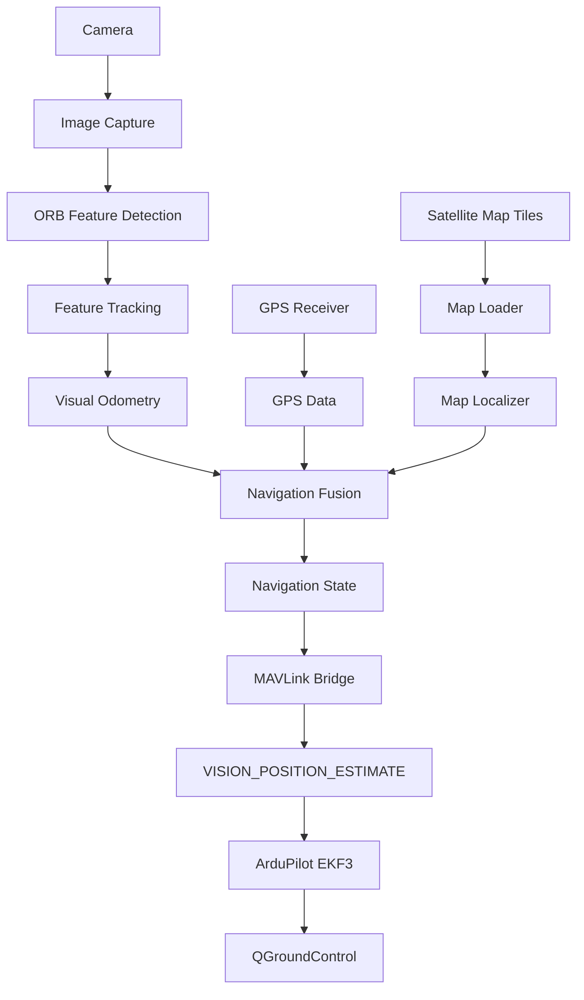

# 🚀 Project Phoenix
### GPS-Denied Navigation System for UAVs

**Project Phoenix** is an experimental UAV navigation system designed to maintain navigation capability when GPS becomes unreliable or unavailable.

It combines multiple navigation sources:

- 🛰️ GPS positioning
- 📷 Visual Odometry (VO) using a camera
- 🗺️ Satellite map-based localization
- 🧠 Navigation source selection and fusion
- 📡 MAVLink communication with ArduPilot
- 🛩️ External navigation integration with EKF3

---

## 1. System Architecture



The system evaluates the health and confidence of available navigation sources and selects the most suitable source based on predefined conditions.

> **Note:** The current fusion implementation is primarily rule-based source selection. It is not yet a complete mathematical Kalman Filter.

---

# 2. Development Environment

### Hardware

- Jetson Orin Nano
- Camera compatible with OpenCV or the configured camera driver
- ArduPilot flight controller
- GPS receiver
- MAVLink communication link
- Ground station running QGroundControl

### Software

| Software | Version / Requirement |
|---|---|
| Operating System | Ubuntu / Linux |
| Python | Python 3 |
| Autopilot | ArduCopter 4.6.3 |
| Estimator | EKF3 |
| Computer Vision | OpenCV |
| Feature Detection | ORB |
| MAVLink | PyMAVLink |
| Map Processing | Rasterio |
| Ground Station | QGroundControl |

The project was developed and tested during integration with **ArduCopter 4.6.3**.

---

# 3. Installation

## Step 1: Install System Dependencies

```bash
sudo apt update
sudo apt upgrade -y

sudo apt install -y \
python3 \
python3-pip \
python3-venv \
python3-dev \
git \
build-essential \
pkg-config \
libopencv-dev \
python3-opencv \
gstreamer1.0-tools \
gstreamer1.0-plugins-base \
gstreamer1.0-plugins-good \
gstreamer1.0-plugins-bad \
gstreamer1.0-plugins-ugly
```

---

## Step 2: Clone the Repository

```bash
git clone https://github.com/YOUR_USERNAME/ProjectPhoenix.git

cd ProjectPhoenix
```

Replace `YOUR_USERNAME` with your GitHub username.

---

## Step 3: Create Python Virtual Environment

```bash
python3 -m venv venv

source venv/bin/activate
```

Upgrade pip:

```bash
pip install --upgrade pip setuptools wheel
```

---

## Step 4: Install Python Dependencies

```bash
pip install numpy opencv-python pymavlink rasterio
```

The main dependencies are:

| Library | Purpose |
|---|---|
| NumPy | Numerical operations and matrix calculations |
| OpenCV | Image processing and computer vision |
| PyMAVLink | Communication with ArduPilot |
| Rasterio | Geospatial raster/map processing |

If a `requirements.txt` file is available:

```bash
pip install -r requirements.txt
```

### Verify Installation

```bash
python -c "import cv2; print(cv2.__version__)"
python -c "import numpy; print(numpy.__version__)"
python -c "from pymavlink import mavutil; print('MAVLink OK')"
python -c "import rasterio; print(rasterio.__version__)"
```

---

# 4. Camera Configuration and Calibration

Visual Odometry performance depends heavily on camera calibration and image quality.

Different cameras have different:

- Focal lengths
- Lens distortion
- Resolution
- Field of view
- Exposure settings
- Frame rates
- Focus characteristics

Therefore, the camera used must be calibrated before using it for navigation.

## Camera Selection

The camera configuration is primarily handled through:

```text
camera/
├── webcam.py
└── calibration.py
```

Modify the camera settings according to the camera being used:

- Camera index or device path
- Resolution
- Frame rate
- Image format
- Exposure
- Focus
- Camera-specific driver or pipeline

For USB cameras, check available devices:

```bash
ls /dev/video*
```

Test the camera:

```python
import cv2

camera = cv2.VideoCapture(0)

print("Camera opened:", camera.isOpened())

ret, frame = camera.read()

if ret:
    print("Frame size:", frame.shape)

camera.release()
```

Change `0` to the appropriate camera index if multiple cameras are connected.

## Camera Calibration

The calibration process should be repeated whenever the camera, lens or operating resolution changes significantly.

Calibration procedure:

1. Print a checkerboard calibration pattern.
2. Capture images at different angles and distances.
3. Ensure the checkerboard appears at different positions across the image.
4. Run the camera calibration script.
5. Calculate the camera intrinsic matrix and distortion coefficients.
6. Save the calibration data.
7. Load the calibration parameters into the Visual Odometry system.

The intrinsic parameters include:

- `fx` – focal length in the X direction
- `fy` – focal length in the Y direction
- `cx` – optical center X
- `cy` – optical center Y

Lens distortion parameters:

- `k1`
- `k2`
- `p1`
- `p2`
- `k3`

The calibration data must correspond to the camera and resolution being used.

---

# 5. Satellite Map Setup

Project Phoenix uses satellite imagery for map-based localization.

Map tiles are downloaded for a defined geographical area and stored locally for use during navigation.

The map subsystem uses:

- Map imagery API
- Reference latitude and longitude
- Square map coverage
- Zoom level
- Local map tile storage

## Map Configuration

The map download configuration requires:

| Parameter | Description |
|---|---|
| API Key | Your own imagery provider API key |
| Latitude | Reference/start latitude for the map area |
| Longitude | Reference/start longitude |
| Area Size | Square area of map coverage |
| Zoom Level | Map resolution |
| Output Folder | Local storage location for downloaded tiles |

The latitude and longitude define the geographical reference point from which the map area is generated.

The square coverage must be large enough to cover the intended test area and flight path.

The current development configuration uses **Zoom Level 18**.

## API Key

Users must generate their own API key from their chosen satellite imagery provider.

Example configuration:

```python
MAP_API_KEY = "YOUR_OWN_API_KEY"

MAP_START_LAT = YOUR_LATITUDE

MAP_START_LON = YOUR_LONGITUDE

MAP_ZOOM = 18

MAP_FOLDER = "data/maps"
```

Replace the latitude and longitude with the geographical coordinates of your own test area.

> ⚠️ Never upload your private API key to GitHub. Use environment variables or a local configuration file excluded through `.gitignore`. Follow your imagery provider's usage, licensing, attribution and billing rules.

Example environment variable:

```bash
export MAP_API_KEY="YOUR_OWN_API_KEY"
```

---

# 6. Loading the Map

Downloaded map tiles must be stored in the expected directory structure.

Project map data is stored under:

```text
ProjectPhoenix/
└── data/
    └── maps/
```

The map subsystem uses the tile manager and map loader to load the local map tiles.

Conceptually:

```python
tiles = TileManager(ZOOM)

loader = MapLoader(
    MAP_FOLDER,
    tiles
)

localizer = MapLocalizer()
```

The map loader loads the map tiles required for localization.

Neighboring tiles can also be loaded to provide map coverage around the current tile.

Example:

```python
neighbor_tiles = loader.preload_neighbors(
    zoom,
    current_tile_x,
    current_tile_y,
    radius=1
)
```

The exact downloader command and its arguments depend on the map downloader implemented in the repository.

---

# 7. Project Structure

```text
ProjectPhoenix/
│
├── main.py
├── config.py
│
├── camera/
│   ├── webcam.py
│   └── calibration.py
│
├── vo/
│   ├── orb_vo.py
│   ├── tracker.py
│   └── pose.py
│
├── map/
│   ├── loader.py
│   ├── tiles.py
│   └── localiser.py
│
├── fusion/
│   ├── ekf.py
│   └── state.py
│
├── mavlink/
│   ├── bridge.py
│   └── sitl.py
│
├── utils/
│
├── data/
│   └── maps/
│
└── venv/
```

### Module Responsibilities

| Module | Responsibility |
|---|---|
| `main.py` | Main application loop and coordination |
| `config.py` | Configuration and thresholds |
| `camera/webcam.py` | Camera capture |
| `camera/calibration.py` | Camera calibration |
| `vo/orb_vo.py` | ORB feature detection and matching |
| `vo/tracker.py` | Feature tracking |
| `vo/pose.py` | Motion and pose estimation |
| `map/loader.py` | Loading map imagery |
| `map/tiles.py` | Tile management and indexing |
| `map/localiser.py` | Satellite-map localization |
| `fusion/ekf.py` | Navigation health and source selection |
| `fusion/state.py` | Navigation state storage |
| `mavlink/bridge.py` | MAVLink telemetry and external navigation |
| `mavlink/sitl.py` | Simulation helpers |

---

# 8. Navigation Source Logic

The system currently evaluates three primary navigation sources.

### GPS

GPS health is evaluated using:

- Fix type
- Satellite count
- HDOP

Current thresholds:

```text
GPS Fix      >= 3
Satellites   >= 8
HDOP         <= 2
```

### Visual Odometry

VO health is based on the confidence generated by the visual tracking system.

```text
VO Confidence >= 0.60
```

VO confidence depends on image feature detection and tracking quality.

### Map Localization

Map localization confidence is checked against:

```text
Map Confidence >= 0.60
```

---

## Source Selection

The current source-selection logic is:

| GPS | VO | Map | Selected Source |
|---|---|---|---|
| Healthy | Healthy | Any | GPS + VO |
| Unhealthy | Healthy | Healthy | MAP + VO |
| Healthy | Unhealthy | Any | GPS |
| Unhealthy | Unhealthy | Healthy | MAP |
| Unhealthy | Healthy | Unhealthy | VO |
| Unhealthy | Unhealthy | Unhealthy | NONE |

The system prioritizes GPS-assisted navigation when GPS is available and healthy.

When GPS becomes unhealthy, Visual Odometry and map localization are used to maintain the navigation estimate.

---

# 9. Navigation State

The navigation state contains the information required by the navigation and MAVLink modules.

Typical state variables include:

```text
GPS Position
VO Position
Map Position

Fused X
Fused Y
Fused Z

Roll
Pitch
Yaw

Velocity
Quaternion

Navigation Source
Confidence
Timestamp
```

The fusion module selects the appropriate source and updates the navigation state.

The project uses a local navigation coordinate system for position calculations. Coordinate frames, signs, scale and conversion between global coordinates and local coordinates must be validated carefully.

---

# 10. MAVLink Bridge

The MAVLink bridge communicates with ArduPilot.

It handles:

- MAVLink connection
- Heartbeat reception
- GPS telemetry
- Attitude telemetry
- Flight mode information
- Navigation transmission
- External Vision messages

The current development connection uses:

```python
connection_string = "udp:127.0.0.1:14551"
```

This is primarily a development/SITL configuration.

Change the connection string according to the actual hardware connection.

Possible connection types include:

- UDP
- Serial
- USB telemetry

## External Vision Transmission

The current integration sends:

```text
VISION_POSITION_ESTIMATE
```

The message includes:

- Timestamp
- X position
- Y position
- Z position
- Roll
- Pitch
- Yaw

The transmission rate is configured at approximately:

```text
30 Hz
```

This data is sent to ArduPilot for use by the EKF3 External Navigation source.

---

# 11. ArduPilot Configuration

The project was developed around:

```text
ArduCopter 4.6.3
EKF3
```

Verify parameter availability and enum values against the exact firmware before configuring another version.

## EKF Configuration

```text
AHRS_EKF_TYPE = 3
EK3_ENABLE = 1
EK2_ENABLE = 0
```

## External Vision

```text
VISO_TYPE = 3

VISO_POS_X = 0
VISO_POS_Y = 0
VISO_POS_Z = 0
```

The position offsets above are placeholders.

Set them according to the actual camera mounting position relative to the flight controller/body reference.

---

## EKF Source Set 1 — GPS

```text
EK3_SRC1_POSXY = 3
EK3_SRC1_VELXY = 3

EK3_SRC1_POSZ = 1
EK3_SRC1_VELZ = 0

EK3_SRC1_YAW = 1
```

This configuration uses GPS for horizontal position and velocity, barometer for vertical position and compass for yaw.

---

## EKF Source Set 2 — External Navigation

```text
EK3_SRC2_POSXY = 6
EK3_SRC2_VELXY = 0

EK3_SRC2_POSZ = 6
EK3_SRC2_VELZ = 0

EK3_SRC2_YAW = 6
```

This configuration uses ExternalNav for position and yaw.

---

## Parameter Configuration Through MAVProxy

Example commands:

```text
param set AHRS_EKF_TYPE 3
param set EK3_ENABLE 1
param set EK2_ENABLE 0

param set VISO_TYPE 3

param set VISO_POS_X 0
param set VISO_POS_Y 0
param set VISO_POS_Z 0

param set EK3_SRC1_POSXY 3
param set EK3_SRC1_VELXY 3
param set EK3_SRC1_POSZ 1
param set EK3_SRC1_VELZ 0
param set EK3_SRC1_YAW 1

param set EK3_SRC2_POSXY 6
param set EK3_SRC2_VELXY 0
param set EK3_SRC2_POSZ 6
param set EK3_SRC2_VELZ 0
param set EK3_SRC2_YAW 6
```

Reboot the flight controller when required.

---

# 12. EKF Source Switching

There are two separate source-selection systems:

1. **Project Phoenix navigation source selection**
2. **ArduPilot EKF3 source-set selection**

Changing the source displayed by Phoenix does not automatically change the source being used internally by ArduPilot.

Source Set 1 is configured for GPS.

Source Set 2 is configured for External Navigation.

A supported source-switch mechanism must be configured and tested independently.

This may involve an auxiliary RC source-set switch or a software-controlled mechanism supported by the firmware.

Verify the source-set switching method and parameter values against ArduCopter 4.6.3 before use.

---

# 13. Running Project Phoenix

Activate the Python environment:

```bash
cd ProjectPhoenix

source venv/bin/activate
```

Run the application:

```bash
python3 main.py
```

Monitor the following:

- Camera feed
- ORB feature count
- VO confidence
- Map confidence
- GPS health
- Navigation source
- Fused position
- MAVLink connection
- External Vision transmission

---

# 14. Testing Procedure

Recommended test sequence:

### Camera

- Verify camera is detected.
- Confirm correct resolution.
- Confirm frame rate.
- Perform calibration.
- Check image quality.

### Visual Odometry

- Test ORB feature detection.
- Test feature tracking.
- Observe VO confidence.
- Test motion estimation.
- Test camera occlusion and loss of features.

### Map Localization

- Download tiles for the test area.
- Confirm correct latitude and longitude.
- Confirm square map coverage.
- Verify tile loading.
- Test map localization confidence.

### MAVLink

- Confirm heartbeat reception.
- Confirm telemetry reception.
- Confirm External Vision messages are being sent.
- Confirm correct connection endpoint.

### SITL

- Run Phoenix with ArduPilot SITL.
- Verify navigation source selection.
- Test GPS loss.
- Test VO fallback.
- Test map fallback.
- Verify ArduPilot EKF source switching separately.

### Hardware Testing

Proceed to controlled hardware testing only after the coordinate frames, timing, offsets, scale, source switching and health checks have been verified.

---

# 15. Current Limitations

- The current fusion logic is rule-based source selection rather than a full Kalman Filter.
- GPS telemetry requires proper timeout/age checks to avoid stale data.
- Phoenix source selection and ArduPilot EKF switching are separate mechanisms.
- Map localization needs further testing.
- Camera calibration is specific to the camera and resolution.
- Coordinate frames and External Vision offsets must be validated.
- GPS-denied autonomous navigation is experimental and has not been operationally validated or certified.

---

# 16. Safety

Project Phoenix is an experimental navigation system.

Testing should be performed:

- First in SITL
- Then in controlled environments
- With a pilot able to take over
- With independent safety mechanisms

Do not rely on this experimental system as the sole navigation source for safety-critical flight.

---

# 17. References

- [ArduPilot Copter Parameters — 4.6.3](https://ardupilot.org/copter/docs/parameters-Copter-stable-V4.6.3.html)
- [ArduPilot Non-GPS Position Estimation](https://ardupilot.org/dev/docs/mavlink-nongps-position-estimation.html)
- [ArduPilot EKF Source Selection](https://ardupilot.org/copter/docs/common-ekf-sources.html)
- [PyMAVLink Documentation](https://mavlink.io/en/mavgen_python/)
- [OpenCV](https://opencv.org/)
- [Rasterio](https://rasterio.readthedocs.io/)

---

## Project Status

**Project Phoenix — Experimental Development**

GPS, Visual Odometry, satellite-map localization and MAVLink integration are being developed and tested as components of a GPS-denied UAV navigation system.
